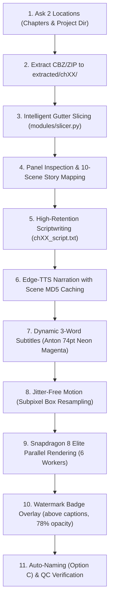

# Manhwa / Webtoon Recap Video Creation Skill

Use this skill whenever you are asked to produce a manhwa or webtoon recap video from raw chapter files (CBZ, ZIP, or image folders).

---

## 🤖 Agent Operating Rules: The 2-Question Protocol

> [!IMPORTANT]
> When this skill is activated, you must **ONLY ask the user two questions** (unless both paths were already provided in the prompt):
> 1. **Chapters Directory (`chapters_dir`)**: Where are the raw chapter files located? *(e.g. `/storage/emulated/0/Mihon/downloads/...` or `./Chapters/`)*
> 2. **Project / Output Directory (`project_dir`)**: Where should the processed files, sliced panels, audio, and output videos be stored? *(e.g. `./Projects/Leveling Up with the Gods/`)*
>
> *(If multiple chapters are discovered in `chapters_dir`, you may also ask or confirm which chapter number to render, defaulting to the earliest or latest).*
>
> **Once these two locations are confirmed, DO NOT stop to ask minor questions or ask for permission on each step.** Take full autonomous ownership and execute the complete 11-phase pipeline below from start to finish.

---

## 📂 Project Directory Standard

Organize all project files within `project_dir` using this clean structure:

```
<project_dir>/
├── extracted/
│   └── ch<XX>/               # Raw extracted webtoon strips (.png, .jpg, .webp)
├── panels/
│   └── ch<XX>/               # Cleanly sliced individual panels (no duplicate cuts)
├── scripts/
│   └── ch<XX>_script.txt     # 10-scene viral high-retention narration script
├── audio/
│   └── ch<XX>/
│       ├── chapter_<XX>_narration.mp3
│       └── chapter_<XX>_subtitles.srt
├── .scene_cache/             # MD5-hashed scene audio & SRT cache (instant re-runs)
└── output/
    └── Chapter <XX>/
        └── [Ch. X] [Plot Hook] - [Series Title] Recap.mp4
```

---

## 🔄 End-to-End Execution Pipeline (11 Phases)



---

### Phase 1: Chapter Extraction & Normalization
1. Check `chapters_dir` for archive formats (`.cbz`, `.zip`, `.rar`, or raw folders).
2. Extract the target chapter into `<project_dir>/extracted/ch<XX>/`.
3. Verify that image files are sorted naturally by numeric index (e.g. `001.png`, `002.png`, etc.).

---

### Phase 2: Intelligent Gutter-Based Slicing
Webtoons are published in ultra-tall vertical continuous strips. Never chop images at arbitrary heights.
1. Run `modules/slicer.py` using `slice_directory()`:
   ```python
   from modules.slicer import slice_directory
   sliced_panels = slice_directory(extract_dir, panels_dir, prefix=f"ch{chapter_num:02d}")
   ```
2. **Gutter Detection Logic**:
   - Converts strips to grayscale and calculates row-level pixel variance standard deviation (`arr.std(axis=1)`).
   - Uniform whitespace / dark gutters have near-zero variance (`std < 4.0`).
   - Slices strictly at true gutters (min gutter height = 20px, min panel height = 150px).
   - Cleanly trims empty borders. Result: 60–100 clean, non-overlapping panels per chapter.

---

### Phase 3: Visual Panel Inspection & 10-Scene Story Mapping
Inspect the sliced panels to map out a 10-scene narrative structure. Every viral short follows this proven dopamine arc:

| Scene # | Narrative Beat | Visual Focus | Animation Type |
| :---: | :--- | :--- | :--- |
| **1** | **Hook & Cold Open** | High tension or protagonist entering dangerous area | `zoom_in` + `scroll` |
| **2** | **Antagonist Threat / Reaction** | Sweating bully / arrogant enemy reacting in fear | `scroll` + `zoom_in` |
| **3** | **Protagonist Indifference** | Protagonist cold deadpan smirk or dismissive dialogue | `scroll` + `scroll` |
| **4** | **Escalation / System Warning** | System penalty screen or countdown timer | `scroll` + `zoom_in` |
| **5** | **The Insane Flex** | Overpowered stat reveal / massive loot dump | `scroll` + `zoom_in` |
| **6** | **Skill Acquisition / Stat Chime** | New ability unlocked / glowing aura | `zoom_in` + `scroll` |
| **7** | **Tactical Respite** | Casual moment (nap, eating, walking alone) | `scroll` + `zoom_in` |
| **8** | **Sudden Climax / Disaster** | Barrier collapse / monster horde invasion | `scroll` + `scroll` |
| **9** | **Instant Karma** | Arrogant enemy squad violently slaughtered | `zoom_in` + `scroll` |
| **10** | **Cliffhanger CTA** | Eyes glowing, crushing item: *"Now I'm up."* | `zoom_in` + `scroll` |

---

### Phase 4: High-Retention Viral Scriptwriting Formula
- **Pacing**: High-speed anime/manhwa recap style (similar to Seekers Comixs / Manga Recaps).
- **Duration Target**: 90–125 seconds total (~220–280 words across 10 scenes, 22–28 words per scene).
- **Tone**: Punchy, energetic, dramatic hyperbole, high dopamine.
- Save narration script to `<project_dir>/scripts/ch<XX>_script.txt`.

---

### Phase 5: Voiceover Synthesis with MD5 Caching
1. **TTS Engine**: Use Microsoft Edge-TTS (`en-US-BrianNeural` at `+15%` rate). It is completely free, high-retention, and requires NO API keys.
2. **Scene-Level Caching**:
   - Compute the MD5 hash of each scene's text.
   - Save to `<project_dir>/.scene_cache/scene_<hash>.mp3` and `.srt`.
   - If a scene was already generated, reuse cached audio immediately.
3. **Fallback Engine**: If ElevenLabs or Groq are configured via environment variables (`ELEVENLABS_API_KEY`, `GROQ_API_KEY`), they can be used, with automatic graceful fallback to Edge-TTS.

---

### Phase 6: Subtitle Alignment & Libass Styling
Subtitles are burned directly into the video for mobile viewing:
- **Font**: `Anton` (from `assets/fonts/Anton-Regular.ttf`).
- **Font Size**: `74pt` (for 1080×1920 9:16 Shorts).
- **Fill Color**: Neon Magenta/Purple (`&H00FF3BE0` / `#E03BFF`).
- **Outline**: `7px` pitch black (`Outline=7, BorderStyle=1`).
- **Alignment**: Centered horizontally (`Alignment=2`).
- **Vertical Position (`MarginV`)**: `480` (places text in the lower third around $y \approx 1350–1440$, ensuring character faces and torso art remain 100% visible).
- **Cues**: 1 to 3 words per cue, uppercase.

---

### Phase 7: Jitter-Free Motion Engine (Subpixel Box Resampling)

> [!CAUTION]
> **NEVER use FFmpeg's native `zoompan` or `crop` filters for Ken Burns motion!**
> FFmpeg evaluates motion coordinates with integer pixel truncation, causing a noticeable 1-pixel vibration/shivering on high-contrast manhwa lines.

**Always use Pillow floating-point subpixel box resampling piped to FFmpeg stdin:**
- **Tall Strips (`aspect ratio > 1.6`)**:
  Scale width to target (1080px) and smoothly scroll vertically down using bilinear interpolation box `(0.0, y0, width, y0 + height)`.
- **Standard Panels (`aspect ratio <= 1.6`)**:
  Format as cinematic frame with blurred, darkened background padding (via `modules/formatter.py`), then apply subpixel Ken Burns zoom from $1.00$ to $1.07$.

---

### Phase 8: Multi-Threaded Parallel Rendering
Harness the full compute power of the device (Snapdragon 8 Elite 8-core Oryon or multi-core desktop CPU):
1. Render all 20 panel video segments concurrently using `ThreadPoolExecutor(max_workers=6)`:
   - FFmpeg encoder: `-c:v libx264 -preset ultrafast -threads 8 -pix_fmt yuv420p`.
2. **Tail Hold Buffer**:
   - Append `end_padding = 1.5s` to the final video clip.
   - Pad the merged audio stream with `apad=pad_dur=1.5` so speech is never abruptly cut off on social platforms.
3. Concatenate video and audio streams via FFmpeg concat demuxer.

---

### Phase 9: Anti-Theft Watermark Badge Overlay
Protect content against scrapers without ruining the viewer's experience:
- **Asset**: Custom PNG crest/die-cut sticker badge (e.g. `assets/nulls_crest_transparent.png`).
- **Size**: Scaled to width `320px`.
- **Position**: Centered horizontally (`x=(W-w)/2`), placed at $y = 1020$ (directly above the subtitle text).
- **Opacity**: `78%` (`colorchannelmixer=aa=0.78`).
- **FFmpeg Filtergraph**:
  ```
  movie='<watermark_path>',scale=320:-1,format=rgba,colorchannelmixer=aa=0.78[wm];[0:v][wm]overlay=(W-w)/2:1020,subtitles='<srt_path>':fontsdir='assets/fonts':force_style='<style_str>'[v_out]
  ```

---

### Phase 10: Automatic Naming Convention (Option C Standard)
Never ask the user for a title. Always name the output file following the high-CTR **Option C format**:

```
[Ch. <Chapter#>] <Clickable Action Hook> - <Series Title> Recap.mp4
```

*Examples:*
- `[Ch. 1] The Underdog Unlocks A Forbidden S-Rank Skill - Fantasy Webtoon Recap.mp4`
- `[Ch. 2] The Guild Master Realizes They Messed With A Monster - Fantasy Webtoon Recap.mp4`

---

### Phase 11: Quality Control & Deliverable Presentation
1. Run `ffprobe` to verify:
   - Resolution: `1080x1920` (or `1920x1080` for 16:9).
   - Video codec: `h264`, Audio codec: `aac`.
   - Duration: 90–130s.
2. Extract a sample preview frame at the climax scene.
3. Present deliverables with clickable `file://` markdown links for the video, audio, srt, script, and preview frame.
